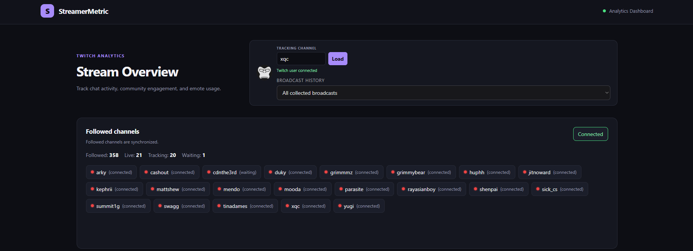
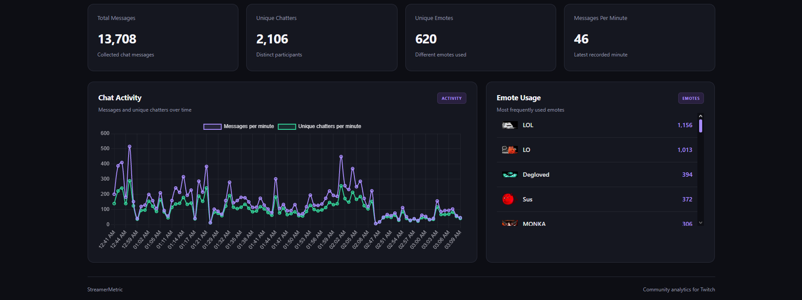

# StreamerMetric

> **Passion project / prototype:** StreamerMetric is a personal project that combines my interest in software development with my interest in the streaming industry. It is intentionally a barebones prototype focused on demonstrating the core Twitch integration, data collection, SQL, API, and dashboard concepts rather than presenting a fully polished or production-ready platform.

StreamerMetric is a local Twitch chat analytics dashboard built with ASP.NET Core, PostgreSQL, Twitch EventSub, and a lightweight browser dashboard.

It tracks chat messages, unique chatters, message activity, emotes, historical broadcasts, and followed live channels. Followed live channels share an EventSub WebSocket and support up to 20 automatic chat subscriptions.

## Dashboard preview

The dashboard uses a Twitch-inspired dark theme to keep live analytics readable and present connection state, followed-channel tracking, and collection capacity in one view.



The analytics view combines summary metrics, chat activity over time, unique-chatter trends, and an emote leaderboard backed by persisted PostgreSQL data.



## Purpose and how it works

StreamerMetric is designed to turn live Twitch chat activity into searchable, persistent analytics. It can monitor followed channels automatically or start collection for any streamer selected through the username search. The dashboard presents the collected data as summary metrics, activity charts, unique-chatter trends, emote usage, leaderboards, and historical broadcast views.

The application is split into three parts:

1. **Browser dashboard** - A lightweight HTML, CSS, and JavaScript client served at `/dashboard`. It calls the API with `fetch`, displays connection and tracking status, and renders analytics with Chart.js.
2. **ASP.NET Core API** - Coordinates Twitch user lookup, OAuth, followed-channel synchronization, live-stream detection, shared EventSub WebSocket subscriptions, chat processing, viewer tracking, and REST responses for the dashboard.
3. **PostgreSQL database** - Stores streamer profiles, broadcasts, viewer snapshots, chatters, chat messages, emotes, followed-channel relationships, and historical analytics.

The main data flow is:

```text
Twitch OAuth / Helix API
          |
          v
ASP.NET Core API ---> PostgreSQL
          ^
          |
Twitch EventSub WebSocket
          |
          v
Browser dashboard ---> REST analytics endpoints
```

When a channel is selected, the API resolves and saves its Twitch profile, checks whether it is live, creates or updates the broadcast record, and starts an EventSub chat subscription. Incoming messages are associated with the correct broadcaster, chatter, broadcast, and emotes before being persisted. Dashboard requests then query the stored records and return aggregate analytics for all broadcasts or a selected historical stream.

For followed channels, a background service periodically synchronizes the account's follows, checks which channels are live, and maintains up to 20 automatic chat subscriptions through shared EventSub transport. This means the browser is an interface to the system, while the API remains responsible for continuous collection and persistence.

## Development Process

### 1. Project foundation and goals

StreamerMetric began as a Twitch analytics application designed to collect chat activity and turn it into useful statistics. The initial goal was to let users search for a Twitch streamer and view information about their stream and chat activity through a dashboard.

The project uses **C# with ASP.NET Core (.NET 10)** for the backend, **PostgreSQL** for persistent storage, and HTML, CSS, and JavaScript for the dashboard. Twitch's Helix API and EventSub were used to retrieve stream information and receive chat messages.

Development was incremental, with an emphasis on building a working data-collection pipeline before expanding the analytics and account features.

### 2. Building the data-collection pipeline

The first major challenge was connecting Twitch data collection to persistent storage. Rather than relying only on in-memory statistics, a PostgreSQL-backed workflow was established so data could be retained for later analysis.

The collection pipeline was organized around several components:

- **Streamer and stream tracking:** Resolve Twitch usernames to broadcaster IDs and save streamer profiles and stream records.
- **Chat collection:** Receive messages through Twitch EventSub.
- **Database persistence:** Store chatters, messages, emotes, and message-emote relationships in PostgreSQL.
- **Viewer tracking:** Periodically record stream information and viewer-count snapshots.
- **Analytics:** Query stored data to calculate chat activity and generate dashboard statistics.

This separation allows the application to collect data independently of individual dashboard requests and makes historical analysis possible.

### 3. Moving from fixed streamers to dynamic lookup

An important design decision was to avoid building the application around specific Twitch channels. The dashboard accepts a Twitch username, resolves it through the API, and uses the returned broadcaster ID for subsequent requests. The streamer is then saved or updated in PostgreSQL.

This workflow was tested with channels including xQc and Yugi. The API returned the correct account information and confirmed that the streamer had been saved successfully. This made StreamerMetric reusable for different channels without requiring code changes whenever a new streamer is selected.

### 4. Debugging database and chat persistence

Connecting to PostgreSQL was only the first part of the problem. The application also needed to verify that Twitch chat messages were being saved and associated with the correct streamer and broadcast.

The persistence workflow was reviewed as follows:

1. EventSub delivers a chat notification.
2. The application identifies and saves the chatter.
3. The repository looks up the active stream record for the broadcaster.
4. The chat message is inserted and associated with that stream.
5. Emote definitions and usage associations are persisted where applicable.

One important edge case is the dependency on an active stream record. If a chat message arrives before the corresponding stream record exists, it may not be persisted through the normal workflow. This highlighted the importance of coordinating stream tracking with chat collection.

Database connectivity was verified, streamer and stream records were inspected, and chat persistence was confirmed through PostgreSQL queries and the application's analytics responses.

### 5. Developing and validating analytics

Once the collection pipeline was working, the next priority was ensuring that the dashboard displayed meaningful statistics derived from stored data.

The analytics include message activity over time, unique chatters, emote usage, and chat leaderboards. Dashboard results were compared with the underlying database records to verify that the aggregates matched.

This established that the project was not only displaying transient in-memory data. The analytics could be recalculated from persisted records after the dashboard or API was restarted.

### 6. Adding historical stream analytics

The original workflow focused on looking up a streamer and viewing aggregate analytics. That did not provide a way to inspect individual past broadcasts, so historical stream selection and per-stream analytics were added.

Users can select a previous broadcast and view statistics associated with that specific stream rather than mixing data from multiple broadcasts. This builds on the stream records and message-to-stream relationships in PostgreSQL and is supported by optional `streamId` filters on the analytics endpoints.

### 7. Investigating continuous data collection

A significant limitation became apparent when considering operation outside the development environment: background collection only runs while the ASP.NET Core application is running.

Starting the API with `dotnet run` starts the background services responsible for stream tracking, viewer snapshots, followed-channel synchronization, and chat collection. When the application stops, those services stop as well.

This led to documenting the difference between hosting and discovery. A continuously hosted API can collect data for known channels, but it also needs a discovery strategy to determine which channels should be tracked.

### 8. Evaluating and implementing automatic streamer discovery

Several tracking approaches were considered:

- **Manual lookup:** A user searches for a streamer, after which StreamerMetric collects data for that channel.
- **Automatic live-stream discovery:** The application periodically discovers live channels through Twitch's API and selects eligible channels for tracking.
- **Followed-channel tracking:** A user authenticates with Twitch, allowing StreamerMetric to synchronize followed channels and prioritize live followed streamers.

The followed-channel approach was implemented because it provides a personalized tracking workflow. OAuth authorization, protected token storage, followed-channel pagination, live detection, account synchronization, and dashboard status reporting were added.

This feature also introduced an EventSub transport constraint. The initial one-WebSocket-per-broadcaster design reached Twitch's transport limit and produced HTTP 429 responses. The connection architecture was then redesigned to use a shared EventSub WebSocket with multiple chat subscriptions routed by broadcaster ID. Automatic followed-channel tracking now supports up to 20 live channels, with additional live channels shown as waiting.

### 9. Current development direction

The project has progressed from a basic streamer lookup workflow to a persistent analytics application with dynamic streamer support, historical stream analysis, Twitch OAuth, followed-channel synchronization, automatic live tracking, and shared EventSub transport.

Future development can focus on:

- Deploying the API and background services to reliable, continuously running hosting.
- Improving reconnect and recovery behavior for long-running EventSub sessions.
- Adding automated tests and reproducible deployment configuration.
- Validating historical analytics across more broadcasts and channels.
- Expanding stream comparisons and engagement insights.
- Adding stronger operational monitoring, backup, and data-retention controls.

Throughout development, the workflow has been to inspect the existing implementation, identify a specific limitation, investigate the relevant Twitch, API, or database behavior, implement changes incrementally, and verify results using API responses, logs, builds, and persisted data before moving on to the next feature.

## Dashboard and visual design choices

The dashboard was intentionally kept lightweight and focused on the information needed while monitoring live channels:

- The **stream overview** is placed first so the selected channel, profile image, search control, and broadcast history are immediately visible.
- The **followed-channel panel** groups Twitch account status, live-channel discovery, tracking capacity, and connection state in one place.
- The **summary cards** provide quick totals before the user moves to the more detailed activity chart and emote leaderboard.
- The **broadcast selector** allows historical analysis without creating a separate page for every stream.
- Live followed channels use a red indicator because red is a familiar visual convention for “live” status, while connection labels distinguish connected, waiting, and error states.
- The layout uses responsive CSS so the overview card, statistics, charts, and channel list remain usable on smaller screens.

The dark visual theme was chosen to mimic the familiar Twitch dark-mode experience and fit the streaming and creator-tool context while keeping high-volume analytics readable over long sessions. Purple is used as the primary accent to create a clear brand identity without competing with the data. Green is reserved for successful connection and synchronization states, red is used for live indicators and errors, and muted gray text is used for secondary information. These choices create a small, consistent status language throughout the dashboard rather than assigning colors decoratively.

The dashboard is implemented with plain HTML, CSS, and JavaScript instead of a frontend framework. That keeps the prototype easy to run, inspect, and adapt while still demonstrating browser API integration, dynamic rendering, responsive layout, and Chart.js visualization.

## Requirements

- .NET 10 SDK
- PostgreSQL 14 or newer
- A Twitch Developer application
- A Twitch account authorized to read followed channels and chat

## 1. Create the database

Create a PostgreSQL database, then run [`Database/schema.sql`](./Database/schema.sql) against it.

For example, with `psql`:

```powershell
psql -U postgres -c "CREATE DATABASE streamermetric;"
psql -U postgres -d streamermetric -f .\Database\schema.sql
```

## 2. Configure local secrets

From the API project directory, store configuration in .NET user secrets. User secrets stay outside the repository and should never be committed.

```powershell
cd .\StreamerMetric.Api

dotnet user-secrets set "ConnectionStrings:DefaultConnection" "Host=localhost;Port=5432;Database=streamermetric;Username=postgres;Password=YOUR_PASSWORD"
dotnet user-secrets set "Twitch:ClientId" "YOUR_TWITCH_CLIENT_ID"
dotnet user-secrets set "Twitch:ClientSecret" "YOUR_TWITCH_CLIENT_SECRET"
dotnet user-secrets set "Twitch:ChatUserId" "YOUR_TWITCH_USER_ID"
```

`Twitch:ChatUserId` is the Twitch user ID that owns the account used to authorize chat access. The dashboard's **Connect Twitch** flow stores the authorized account tokens encrypted in PostgreSQL.

## 3. Configure Twitch

In the Twitch Developer Console, add this exact OAuth redirect URI to the application:

```text
http://localhost:5168/api/twitch/account/callback
```

The redirect URI must match the local API URL exactly.

## 4. Run the application

From the repository root:

```powershell
dotnet run --project .\StreamerMetric.Api\StreamerMetric.Api.csproj --launch-profile http
```

The configured launch profile opens the dashboard automatically. If it does not, open:

<http://localhost:5168/dashboard>

The dashboard is served by the API, so it works consistently in Opera, Chrome, Edge, Firefox, and the VS Code browser. No Live Server extension is required.

## Dashboard workflow

1. Select **Connect Twitch** and authorize the local Twitch account.
2. Followed channels that are live are detected automatically.
3. Up to 20 live followed channels are tracked through shared EventSub transport.
4. Search any Twitch username to collect chat independently of the followed-channel list.
5. Select a historical broadcast to view stream-specific analytics.

## Twitch sign-in safety disclaimer

The **Connect Twitch** flow uses Twitch's official OAuth authorization process. StreamerMetric does not collect, process, or store your Twitch password. Sign-in takes place on Twitch's official authorization page, and Twitch redirects back to the locally running application only after authorization is completed.

Before approving access, verify that:

- The browser address is on an official `twitch.tv` domain during sign-in.
- The requested permissions are the expected read-only scopes for followed channels and chat.
- The callback returns to your own local application at `http://localhost:5168/api/twitch/account/callback`.
- You are running the intended local copy of StreamerMetric and have not followed an unexpected authorization link.

The application stores OAuth access and refresh tokens protected with ASP.NET Core Data Protection in the local PostgreSQL database. Do not share authorization URLs, tokens, database contents, or screenshots containing credentials. Disconnect the account from the dashboard or delete the local database if you no longer want this installation to retain its authorization.

## Configuration notes

- `localhost` refers to the computer running the API.
- Each developer or portfolio reviewer needs their own PostgreSQL instance, Twitch application credentials, and Twitch redirect URI registration.
- Twitch client secrets, access tokens, refresh tokens, database passwords, and user-secrets files must not be committed.
- The API uses port `5168` for the HTTP profile and `7177` for HTTPS.
- If the API URL or port is changed, update the Twitch redirect URI and launch profile together.

## Important limitations

- **The API must stay running to collect data.** Chat messages, viewer snapshots, stream discovery, followed-channel synchronization, and EventSub notifications are collected by background services in the API process. Closing the terminal, stopping debugging, or shutting down the computer pauses collection.
- **Historical data is not backfilled automatically.** If the API is stopped while a channel is live, messages and viewer snapshots from that period are not recovered later. Twitch does not provide this application with a complete historical chat replay.
- **The dashboard is not the collector.** Closing Opera, VS Code, or another browser does not stop collection as long as the API remains running. Conversely, leaving the dashboard open cannot collect data if the API is stopped.
- **Data is stored locally.** Analytics are saved to the configured PostgreSQL database on the machine running the API. A different computer will not see the same data unless the database is migrated or hosted remotely.
- **Twitch authorization is local and user-specific.** Each installation must authorize its own Twitch account. OAuth tokens are protected before being stored, but losing the local database or application data requires connecting Twitch again.
- **Twitch API and EventSub limits apply.** Rate limits, authorization scopes, account permissions, WebSocket availability, subscription limits, and Twitch outages can delay or prevent collection.
- **Automatic followed-channel tracking is capped at 20 live channels.** Additional live followed channels remain in a waiting state until capacity becomes available. Manual username search can still select channels independently, but all subscriptions share Twitch EventSub resources.
- **A live stream must be detected before chat can be associated with it.** Messages received before the stream record exists may not be included in that broadcast's persisted analytics.
- **The application is intended for local development** It does not currently include production hosting, multi-user authentication, automatic backups, distributed workers, or high-availability recovery.

## PostgreSQL and SQL implementation

StreamerMetric uses PostgreSQL as its persistent analytics store. The ASP.NET Core API connects through the `Npgsql` ADO.NET provider using the `ConnectionStrings:DefaultConnection` configuration value. Database access is organized into repository classes rather than being mixed into the API endpoints:

- `StreamerRepository` manages streamer profiles, broadcast records, stream lifecycle updates, viewer snapshots, and broadcast history.
- `ChatRepository` stores chatters, messages, emotes, message-emote relationships, and analytics queries.
- `TwitchAccountRepository` manages the connected Twitch account, encrypted OAuth token values, followed-channel relationships, and synchronization state.

The schema is normalized around relationships between streamers, broadcasts, chat messages, chatters, emotes, viewer snapshots, and followed-channel associations. Foreign keys maintain referential integrity, while cascade behavior removes dependent followed-channel records when the connected account is removed. PostgreSQL indexes support the main lookup paths, including stream history, stream-scoped chat queries, chatter lookups, and time-ordered viewer snapshots.

The data layer uses several production-oriented SQL patterns:

- **Parameterized SQL commands** through `NpgsqlCommand`, keeping user and Twitch data separate from SQL text and avoiding string-concatenated queries.
- **Idempotent upserts** with `INSERT ... ON CONFLICT DO UPDATE`, allowing Twitch profiles, broadcasts, chatters, accounts, and followed-channel records to be synchronized without duplicate rows.
- **Duplicate protection** with unique constraints and `ON CONFLICT DO NOTHING`, including Twitch message IDs so reconnects or repeated notifications do not duplicate chat data.
- **Transactions** for followed-channel synchronization so a complete Twitch follow list is applied consistently as one database operation.
- **Relational joins** to resolve Twitch IDs to internal primary keys and associate each message with its chatter, broadcast, and streamer.
- **Aggregate analytics** using `COUNT`, `COUNT(DISTINCT ...)`, `SUM`, `GROUP BY`, `ORDER BY`, and PostgreSQL's `date_trunc('minute', ...)` for messages-per-minute, unique-chatters-per-minute, emote leaderboards, and viewer history.
- **Nullable stream filtering** so the same analytics queries can return all collected broadcasts or a selected historical broadcast without duplicating query implementations.
- **Async connection and command handling** with `OpenAsync`, `ExecuteNonQueryAsync`, `ExecuteScalarAsync`, and `ExecuteReaderAsync` so database operations do not block the API request thread.

The collection pipeline is:

1. Twitch EventSub delivers a chat notification to the API.
2. The API upserts the chatter identity.
3. The current open broadcast is resolved with a join between `streams` and `streamers`.
4. The message is inserted with a relationship to the broadcast and chatter.
5. Emotes are normalized into `emotes` and linked through `chat_message_emotes`.
6. Dashboard endpoints run aggregate SQL over the normalized records to produce analytics.

This approach deliberately uses explicit SQL and repository boundaries instead of an ORM. It provides direct control over PostgreSQL constraints, conflict handling, joins, aggregation, and query performance while keeping persistence concerns separate from Twitch integration and dashboard HTTP routes.

## API implementation and endpoint reference

The API is implemented with ASP.NET Core Minimal APIs. Endpoints are mapped in `StreamerMetric.Api/Program.cs` and return JSON using the standard `Results.Ok`, `Results.NotFound`, `Results.BadRequest`, and `Results.Problem` responses. The local base URL is:

```text
http://localhost:5168
```

### Application and database

| Method | Endpoint | Purpose |
|---|---|---|
| `GET` | `/` | Returns API name, status message, and version. |
| `GET` | `/api/database/test` | Opens PostgreSQL and reports connection status and public table count. |
| `GET` | `/api/streamers` | Returns streamers saved in the database. |

Example:

```powershell
Invoke-RestMethod http://localhost:5168/api/database/test
```

### Twitch discovery and stream preparation

| Method | Endpoint | Purpose |
|---|---|---|
| `GET` | `/api/twitch/user/{username}` | Resolves a Twitch login, saves the streamer profile, and returns the Twitch identity. |
| `GET` | `/api/twitch/stream/{username}` | Checks whether a streamer is live, upserts the broadcast, and stores an initial viewer snapshot. |
| `GET` | `/api/twitch/streams/history/{broadcasterId}` | Returns historical broadcasts for a broadcaster. |
| `GET` | `/api/twitch/analytics/{streamId}` | Returns stored analytics for one broadcast. |

Typical dashboard flow:

```text
GET  /api/twitch/user/xqc
GET  /api/twitch/stream/xqc
POST /api/twitch/chat/connect/71092938/start
GET  /api/twitch/chat/analytics/persistent/71092938
```

The username lookup uses Twitch's Helix API with an application access token. The result is saved locally so later stream and chat records can reference the internal streamer row.

### Chat connection and collection

| Method | Endpoint | Purpose |
|---|---|---|
| `POST` | `/api/twitch/chat/connect/{broadcasterId}/start` | Starts chat collection for a broadcaster through Twitch EventSub. |
| `GET` | `/api/twitch/chat/connect/{broadcasterId}` | Starts a connection and waits for the connection task to close; retained for compatibility. |
| `GET` | `/api/twitch/chat/status/{broadcasterId}` | Returns `Connecting`, `Connected`, `Offline`, or `Error` status. |

Example:

```powershell
Invoke-RestMethod `
  -Method Post `
  http://localhost:5168/api/twitch/chat/connect/71092938/start

Invoke-RestMethod `
  http://localhost:5168/api/twitch/chat/status/71092938
```

The shared EventSub WebSocket receives notifications, resolves the broadcaster from the event payload, persists chat messages and emotes, and updates in-memory analytics. The automatic followed-channel service uses the same shared transport.

### OAuth and followed-channel account management

| Method | Endpoint | Purpose |
|---|---|---|
| `GET` | `/api/twitch/account/connect` | Creates a Twitch authorization URL for the dashboard. |
| `GET` | `/api/twitch/account/callback` | Receives the Twitch OAuth callback, stores the account, synchronizes follows, and redirects to `/dashboard`. |
| `GET` | `/api/twitch/account/status` | Returns connected-account metadata and last successful sync time. |
| `GET` | `/api/twitch/account/followed-channels` | Returns synchronized followed channels. |
| `POST` | `/api/twitch/account/sync` | Forces a followed-channel synchronization. |
| `POST` | `/api/twitch/account/disconnect` | Removes the locally connected Twitch account and its followed-channel associations. |
| `GET` | `/api/twitch/account/tracking-status` | Returns live, tracking, waiting, and connection status for followed channels. |

The dashboard calls `/api/twitch/account/connect`, redirects the browser to the returned `authorizationUrl`, and receives the OAuth callback at the registered Twitch redirect URI. The callback redirects back to the dashboard with a short success or error status rather than exposing a raw JSON response in the browser.

### Persistent analytics

All persistent analytics endpoints accept an optional `streamId` query parameter when the user wants to inspect one historical broadcast instead of all collected broadcasts.

| Method | Endpoint | Purpose |
|---|---|---|
| `GET` | `/api/twitch/chat/analytics/persistent/{broadcasterId}` | Returns total messages, unique chatters, and unique emotes. |
| `GET` | `/api/twitch/chat/analytics/stream/{broadcasterId}/{streamId}` | Returns the same analytics for an explicit broadcast. |
| `GET` | `/api/twitch/chat/analytics/messages-per-minute/{broadcasterId}` | Returns message counts grouped by minute. |
| `GET` | `/api/twitch/chat/analytics/unique-chatters-per-minute/{broadcasterId}` | Returns distinct chatter counts grouped by minute. |
| `GET` | `/api/twitch/chat/analytics/emotes-per-minute/{broadcasterId}` | Returns emote usage grouped by minute. |
| `GET` | `/api/twitch/chat/leaderboard/{broadcasterId}` | Returns the emote usage leaderboard. |
| `GET` | `/api/twitch/chat/analytics/{broadcasterId}` | Returns the current in-memory minute statistics, with an optional `minute` query parameter. |
| `GET` | `/api/twitch/emotes/7tv/{broadcasterId}` | Returns third-party emote image URLs for the dashboard. |

Examples:

```text
GET /api/twitch/chat/analytics/persistent/71092938
GET /api/twitch/chat/analytics/persistent/71092938?streamId=42
GET /api/twitch/chat/analytics/messages-per-minute/71092938?streamId=42
GET /api/twitch/chat/leaderboard/71092938?streamId=42
```

The dashboard loads these endpoints with JavaScript `fetch`, then renders the returned JSON into Chart.js datasets, summary cards, broadcast selectors, and the emote leaderboard.

## Validation

Build the API:

```powershell
dotnet build .\StreamerMetric.Api\StreamerMetric.Api.csproj
```

Validate the dashboard script:

```powershell
node --check .\StreamerMetric.Dashboard\app.js
```
